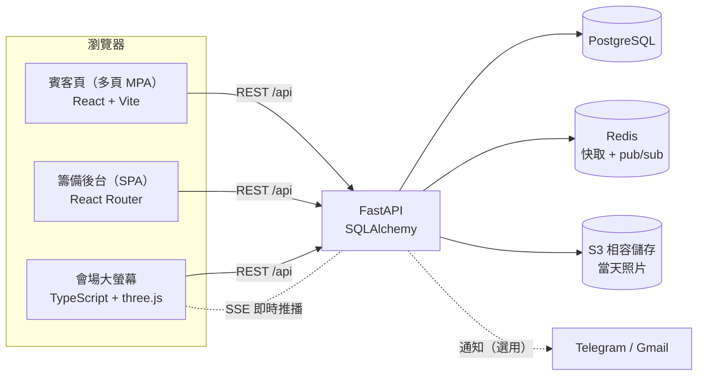

# Wedding-Invite：婚禮網站與籌備後台

> **English summary** — A full-stack wedding website built for our own wedding (Sep–Oct 2026) and used by real guests. Guests answer a two-stage RSVP, look up their table on the day (with walking directions on a 2D floor plan), send live messages to a big screen at the venue, and upload photos. The couple and helpers manage guests, seating, gift boxes, budget, schedule and the venue big screen from a role-based admin panel. React + Vite (TypeScript/three.js for the big screen), FastAPI + PostgreSQL + Redis, S3 for photo storage, deployed on AWS EC2 behind Cloudflare. ~585 commits in about five weeks, 105 backend tests + 25 frontend tests. Built with AI-assisted development (Claude Code); requirements, product decisions and acceptance by Omena.

## 為什麼做這個

籌備婚禮時，出席調查、葷素與兒童座椅統計、排座位、喜餅發送和預算付款分散在 Google 表單、Excel 和 LINE 對話裡，資料重複又容易對不上。我們想要一個地方：

- **賓客**用手機就能回覆，長輩也看得懂；
- **新人**在同一個後台看到名單、座位、喜餅、花費與時程；
- **婚禮當天**賓客自己查桌次、把祝福送上會場大螢幕，不用有人一直帶位。

這個網站從 2026-09-02 開始開發，實際發給親友使用，2026-10-06 搬到新的平台後正式站關閉，這個 repo 保留完整的開發紀錄。

## 使用者與主要功能

| 使用者 | 功能 |
|---|---|
| 賓客（不用登入） | **兩階段回覆**：`/rsvp` 先調查出席意願與人數，`/details` 第二階段再用電話或 Email 驗證後確認主餐、素食、兒童身高與座椅、過敏提醒 |
| | **桌次查詢** `/seat`：輸入姓名、電話或 Email，大字顯示桌號與座位，並在 2D 平面圖上畫出從入口走到座位的路線 |
| | **現場留言** `/wish`：掃大螢幕上的 QR code 留言，幾秒後出現在會場大螢幕（可設定先審核） |
| | **當天照片上傳** `/upload`：多選原檔上傳，只有新人看得到 |
| 新人（管理者） | 名單與菜單、**座位圖編輯器**（分「安排座位／編輯場地」兩種模式、多廳、飯店平面圖範本）、**喜餅**（多家廠商、送餅名單、分批簽收與代領）、花費與婚宴費用預估、行事曆、筆記、活動環節、當天物品清單、文件庫、相簿權限 |
| | **階段開關**：各賓客頁何時開放由後台控制，登入者可預覽尚未開放的頁面 |
| 幫手（招待、伴郎伴娘） | 以**權限矩陣**控制能用哪些功能（例如只看名單和報到、喜餅簽收），看不到預算與合約 |
| 會場大螢幕 `/wall` | 播放動畫、音樂、逐字歌詞與賓客留言；新人可用手機遙控切換內容 |

## 技術架構



- **前端**：React 18 + Vite。賓客頁是多頁應用（每頁各自打包、網址固定），籌備後台是單頁應用；大螢幕以 TypeScript + three.js 撰寫，在瀏覽器裡分析節拍並排版。
- **後端**：FastAPI + SQLAlchemy（pg8000）+ PostgreSQL；Redis 用於快取，並用 pub/sub 讓多個 uvicorn worker 共用大螢幕的即時推播（SSE），沒有 Redis 時退回輪詢。
- **檔案**：當天照片在設定 `S3_BUCKET` 時存到 S3（私有 bucket，經後端驗證後才能讀取），否則存在本機；縮圖用 Pillow／pillow-heif（支援 HEIC）。
- **部署（已關閉）**：AWS EC2（nginx + systemd + uvicorn）前面接 Cloudflare。前後端由同一個 port 提供。
- **品質**：後端 pytest 105 項、前端 node:test 25 項、ESLint、大螢幕 `tsc --noEmit` 型別檢查。

## 產品決策與迭代紀錄

約 585 個 commit、五週內完成，大部分改動來自實際使用後的回饋。完整紀錄在 [`docs/改版進度.md`](docs/改版進度.md)，以下是幾個例子：

- **座位圖改成「以桌為單位」（9/15）**：使用者反映椅子太小、名字看不到、排人時桌子會被拖走。把座位圖拆成「安排座位」與「編輯場地」兩種模式，點桌子打開大字座位表，空位不夠時先詢問再放。
- **拿掉 3D、改用 2D 地圖**：原本做了 three.js 的 3D 會場模型，試用後依新人要求全部移除，改用 2D 平面圖加上避開障礙物的路線指引（BFS）。
- **照片存 S3 而不是擴充硬碟（9/27）**：比較費用後選擇用多少付多少的 S3，bucket 保持私有，照片一律透過要登入的 API 讀取。
- **角色權限可在後台設定（9/27）**：從寫死的「新人／幫手」改成可勾選的權限矩陣，讓招待只拿到婚禮當天需要的功能。
- **領域模型先講清楚**：喜餅與人情往來容易混淆（出席的人不一定收喜餅、收件人不一定是送禮對象），先在 [`CONTEXT.md`](CONTEXT.md) 定義名詞，再設計資料表，見 [`docs/喜餅與人情往來設計.md`](docs/喜餅與人情往來設計.md)。
- **介面一致性規範**：賓客頁不使用瀏覽器原生下拉、日期與確認框，統一用自製元件，避免不同手機上長得不一樣、長輩看不懂。
- **已發出去的網址不改**：`/`、`/rsvp`、`/details` 已經發給賓客，新功能一律加新頁面。

## 在本機執行

需要 Node.js 20.19+ 與 Python 3.10+。

**快速預覽**（SQLite、虛構賓客、不寄任何通知，不需要 PostgreSQL／Redis）：

```bash
cd frontend
npm ci
npm run build
cd ../backend
python -m venv .venv
.venv/Scripts/python -m pip install -r requirements.txt   # macOS/Linux：.venv/bin/python
cd ..
backend/.venv/Scripts/python scripts/preview_local.py
# 開 http://127.0.0.1:8010 ，後台密碼見 scripts/preview_local.py 檔頭
```

大螢幕與現場留言的預覽用 `scripts/wall_preview.py`（用法寫在檔頭）。

**完整環境**（PostgreSQL + Redis）：

```bash
cp backend/.env.example backend/.env    # 修改資料庫連線、ADMIN_PASSWORD、SECRET_KEY
cd backend && .venv/Scripts/python -m uvicorn app.main:app --port 8000
```

Windows 上也可以用 `scripts/start.ps1`／`scripts/stop.ps1` 一鍵啟動本機的 PostgreSQL、Redis 與網站（資料目錄規則見 `scripts/paths.ps1`）。

**測試**：

```bash
cd backend && .venv/Scripts/python -m pip install -r requirements-dev.txt && .venv/Scripts/python -m pytest -q
cd frontend && npm test && npm run lint && npx tsc --noEmit -p src/wall
```

## 部署

正式站已於 2026-10-06 關閉。當時的部署方式：

1. 在本機 `npm run build`，打包 `backend/app`、`requirements.txt` 與 `frontend/dist`。
2. 上傳到伺服器，執行 `scripts/deploy_remote.py`（先備份，再替換程式；失敗自動還原）。部署目錄由環境變數 `WEDDING_DEPLOY_ROOT` 指定。
3. 伺服器上用 systemd 管理 uvicorn，nginx 反向代理，前面接 Cloudflare。

密碼、金鑰與 `.env` 一律不進 Git；`backend/.env.example` 只有範例值。

## 文件

- [`使用說明.md`](使用說明.md)：每個網址與功能的操作說明（給新人與幫手看）
- [`docs/改版進度.md`](docs/改版進度.md)：逐日改版紀錄
- [`docs/wall/`](docs/wall/)：大螢幕引擎、版面與內容設計
- [`CLAUDE.md`](CLAUDE.md)：給 AI 開發助手的專案規則

## 開發方式

AI 輔助開發（Claude Code），由 Omena 主導需求與驗收：提出需求、實際使用、回報問題並決定優先順序，AI 依照 `CLAUDE.md` 的規則實作、寫測試並自我驗證。

共同開發：Alan（[alanting9999](https://github.com/alanting9999)）

## 授權與素材

大螢幕引擎改寫自 pdoom-video（MIT，見 `frontend/src/wall/engine/LICENSE`）；字型依各自授權（例如 OFL）。喜帖原稿 PDF 因含家人姓名，未收錄在這個 repo 中，`scripts/render_invitation.py` 需要自行提供 PDF 才能執行。
